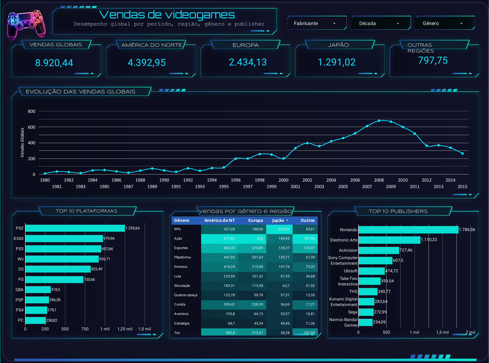

# Vendas de Videogames (1980–2015) | Looker Studio + Python

Análise do mercado de videogames em mídia física com **16.596 títulos** que venderam mais de 100 mil cópias. O projeto mostra como o mercado evoluiu, de quanto ele depende de poucos sucessos e como as preferências mudam entre regiões, plataformas e publishers.

<a href="imagens/dashboard-vendas-videogames.png">
  
</a>

*Clique na imagem para ver o dashboard em tamanho completo.*

**[Acessar o dashboard interativo no Looker Studio](https://lookerstudio.google.com/reporting/03f64a8d-c3bc-4b8b-a985-d6d23563d9c2)** · [Notebook de análise](notebooks/analise_vendas_videogames.ipynb) · [Relatório em PDF](relatorio/dashboard-vendas-videogames.pdf)

> Todos os valores de vendas estão em **milhões de unidades físicas vendidas**. A base não tem receita.

---

## Perguntas de negócio

As perguntas foram pensadas do ponto de vista de um gestor de uma publisher ou de uma varejista de games.

| # | Pergunta | Por que importa | Resposta |
| --- | --- | --- | --- |
| 1 | Como o mercado evoluiu e quando foi o auge? | Mostra o ciclo de vida das gerações de console | O pico foi em **2008** (678,9 mi). Em 2015 as vendas estavam **61% abaixo** do pico |
| 2 | Quanto as vendas dependem de poucos sucessos? | Define o risco do portfólio | **1% dos títulos = 21% das vendas** e 20% dos títulos = 75%. A mediana é 0,17 mi por título, contra uma média de 0,54 |
| 3 | Onde estão as vendas por região? | Orienta verba de marketing e estoque | América do Norte **49,2%**, Europa 27,3%, Japão 14,5% e Outras 8,9% |
| 4 | As preferências de gênero mudam entre regiões? | Mostra se um lançamento global funciona igual em todo lugar | Sim. **RPG é 27% das vendas no Japão** e 7–8% no Ocidente. **Tiro é 13%** no Ocidente e **3%** no Japão |
| 5 | Quais fabricantes e plataformas dominam? | Indica para qual console lançar | **Sony 40,1%** e **Nintendo 39,5%** praticamente empatam. O **PS2** é a plataforma líder (1.255,64 mi) |
| 6 | Quais publishers lideram e quem é mais eficiente por título? | Separa volume de qualidade de catálogo | A **Nintendo** lidera em vendas (20%) e em média por título (**2,54 mi**, contra 0,82 da EA) |
| 7 | Quais gêneros vendem mais por título lançado? | Mostra onde cada aposta rende mais | **Ação** lidera em volume, mas é o gênero mais concorrido. **Plataforma (0,94 mi)** e **Tiro (0,79 mi)** vendem mais por título |

### O que esta base **não** responde

- **Receita, preço e margem.** Há apenas unidades vendidas.
- **Vendas digitais** (Steam, PSN, eShop). A base cobre só mídia física, então a queda depois de 2010 é, em parte, a migração para o digital.
- **O mercado depois de 2015.** A coleta parou em 2016 e esse ano está incompleto, por isso fica fora da linha do tempo.
- **Jogos com menos de 100 mil cópias.** A cauda longa de lançamentos não está na base.
- **O mercado brasileiro.** O Brasil está agregado em "Outras regiões".
- **Causalidade.** A base mostra o que vendeu, não por que vendeu: não há preço, marketing nem nota da crítica.

---

## Indicadores principais

| Indicador | Resultado | % do global |
| --- | ---: | ---: |
| Vendas globais | 8.920,44 mi | 100% |
| América do Norte | 4.392,95 mi | 49,2% |
| Europa | 2.434,13 mi | 27,3% |
| Japão | 1.291,02 mi | 14,5% |
| Outras regiões | 797,75 mi | 8,9% |
| Títulos analisados | 16.596 | — |
| Plataformas / Publishers / Gêneros | 31 / 578 / 12 | — |

*A soma das quatro regiões (8.915,85) difere do global em 0,05% por causa de arredondamentos da própria fonte.*

## Principais insights

1. **O mercado de mídia física teve seu auge em 2008**, na geração Wii / Xbox 360 / PS3. A queda seguinte coincide com o crescimento do digital, que não aparece na base.
2. **É um mercado de hits.** A média por título engana: para projetar um lançamento, a mediana (0,17 mi) é a referência mais realista.
3. **Um plano global único desperdiça verba.** O Japão tem um perfil próprio: RPG domina e Tiro quase não vende. Além disso, o peso do Japão no mercado caiu de 29% nos anos 90 para 11% nos anos 2000.
4. **Há duas estratégias vencedoras entre as publishers.** A Nintendo aposta em poucas franquias fortes (702 títulos, 2,54 mi por título). A Electronic Arts aposta em volume (1.350 títulos, 0,82 mi por título).
5. **Volume não é sinônimo de oportunidade.** Ação tem 3.316 títulos disputando vendas. Plataforma e Tiro rendem mais por lançamento, com bem menos concorrência.

---

## Dashboard

O dashboard foi construído no **Looker Studio** e tem:

- **5 cards** de vendas por região, que somam o total global;
- **filtros** por fabricante, década e gênero;
- uma **linha do tempo** de 1980 a 2015;
- os rankings **Top 10 plataformas** e **Top 10 publishers**;
- uma **matriz gênero × região** com mapa de calor.

A identidade visual (molduras neon em gradiente azul → ciano) foi criada para o projeto.

## Base de dados e tratamento

**Fonte:** base pública *Video Game Sales*, extraída do VGChartz em 2016. Ela tem 16.598 registros de jogos com mais de 100 mil cópias vendidas.

| Problema encontrado | Linhas | Decisão |
| --- | ---: | --- |
| `Year` vazio | 271 | Mantidas nos totais e excluídas apenas da análise por ano |
| `Publisher` vazio | 58 | Preenchido como `Unknown`, padrão que a própria fonte já usa |
| Registros duplicados (Madden NFL 13 – PS3; Wii de Asobu: Metroid Prime – Wii) | 2 | Somados ao registro principal (16.598 → 16.596) |
| Anos 2017 e 2020 | 4 | Erros de cadastro, já que a coleta é de 2016. Ficam fora da linha do tempo |
| Ano de 2016 | 344 | Coleta incompleta. Fica fora da linha do tempo |

Colunas criadas no tratamento: `Fabricante`, `Tipo_Plataforma` (console de mesa, portátil ou PC), `Genero_PT`, `Decada` e `Ano_Completo` (sinaliza os anos de 1980 a 2015).

### Dicionário de campos

| Campo | Descrição |
| --- | --- |
| Rank | Posição do jogo no ranking de vendas globais |
| Name | Nome do jogo |
| Platform | Plataforma (ex.: PS2, Wii, X360) |
| Year | Ano de lançamento |
| Genre / Genero_PT | Gênero, em inglês e em português |
| Publisher | Empresa publicadora |
| NA_Sales | Vendas na América do Norte (EUA e Canadá) |
| EU_Sales | Vendas na Europa |
| JP_Sales | Vendas no Japão |
| Other_Sales | Vendas nas demais regiões, incluindo o Brasil |
| Global_Sales | Vendas globais |
| Fabricante | Nintendo, Sony, Microsoft, Sega, PC ou Outros |
| Tipo_Plataforma | Console de mesa, Portátil ou PC |
| Decada | Década de lançamento |
| Ano_Completo | "Sim" para os anos de 1980 a 2015, usados na linha do tempo |

## Estrutura do repositório

```text
dashboard-looker/
├── dados/
│   ├── vgsales_original.csv          # base original (16.598 registros)
│   └── vgsales_tratado.csv           # base tratada, usada no dashboard
├── notebooks/
│   └── analise_vendas_videogames.ipynb
├── imagens/
│   ├── dashboard-vendas-videogames.png
│   └── graficos/                     # gráficos exportados pelo notebook
├── relatorio/
│   └── dashboard-vendas-videogames.pdf
├── requirements.txt
└── README.md
```

## Como reproduzir

```bash
pip install -r requirements.txt
jupyter notebook notebooks/analise_vendas_videogames.ipynb
```

O notebook lê `dados/vgsales_original.csv`, aplica o tratamento, gera `dados/vgsales_tratado.csv` e calcula todos os números citados neste README.

## Ferramentas

- **Python** (pandas, NumPy, Matplotlib, Seaborn): tratamento, análise e gráficos
- **Google Planilhas**: fonte de dados do dashboard
- **Looker Studio**: dashboard interativo

## Autor

**Leandro Gomes**
[GitHub](https://github.com/leandroanalytics) · [LinkedIn](https://www.linkedin.com/in/leandroanalytics) · [Dashboard interativo](https://lookerstudio.google.com/reporting/03f64a8d-c3bc-4b8b-a985-d6d23563d9c2)
